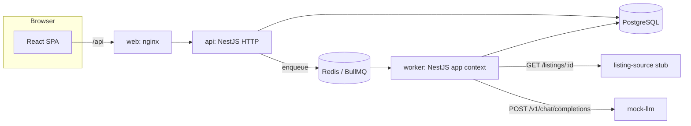
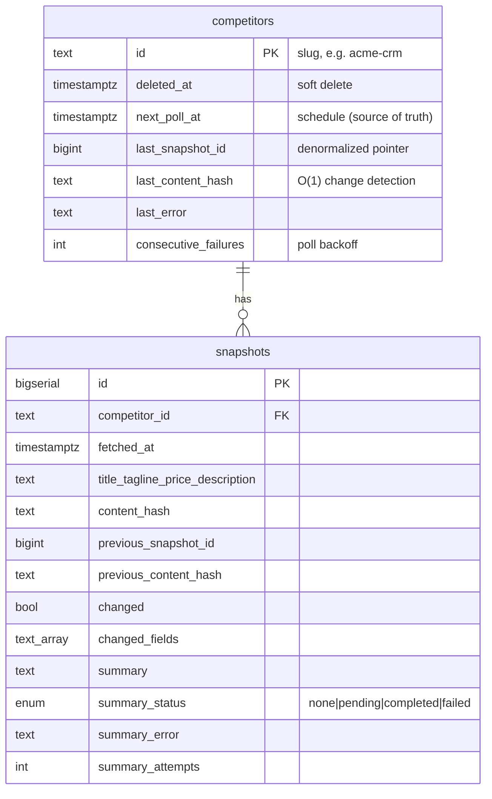
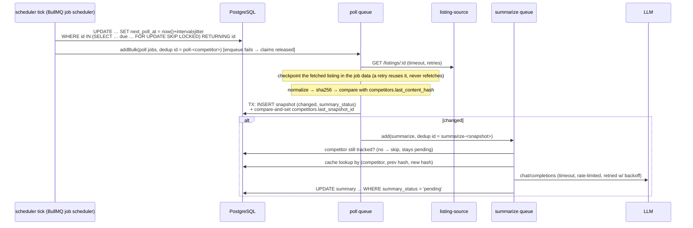

# Architecture

## Components



The `api` and `worker` services run from **one codebase and one image** with two entrypoints (`main.ts`, `worker.ts`). The API only enqueues jobs and never runs workers. That means slow LLM calls never compete with HTTP requests, and each side can be scaled or restarted on its own.

## Layers (backend)

```
controller  ->  service  ->  repository  ->  Prisma/PostgreSQL
 (HTTP, DTO      (business     (only layer that
  validation,     rules, throws  knows SQL/Prisma)
  mapping)        domain errors)
processor   ->  service   (queue entrypoints are thin, like controllers)
```

- **Controllers** validate input with class-validator DTOs and map DB rows to the shared contract types (`packages/contracts`, used by the frontend too).
- **Services** throw domain errors (`NotFoundError`, `ConflictError`, `InvalidStateError`). `DomainExceptionFilter` maps those to HTTP status codes, so services stay HTTP-agnostic and can be reused by queue processors.
- **Repositories** hold all queries. These include the two hand-written SQL statements: the scheduler claim and the failure backoff.
- **Ports** (`ListingSourceClient`, `LlmProvider`) are DI tokens with one adapter each. Swapping the stub for a real scraper, or the mock for OpenAI, Anthropic or Ollama, is a single class change.

## Data model



Indexes. The partial indexes are hand-written in the migration:

| Index | Serves |
| --- | --- |
| `snapshots (competitor_id, fetched_at DESC, id DESC)` | timeline, keyset pagination |
| `competitors (next_poll_at) WHERE deleted_at IS NULL` | scheduler "who is due" |
| `snapshots (competitor_id, previous_content_hash, content_hash) WHERE summary_status='completed'` | summary cache (per competitor) |
| `snapshots (created_at) WHERE summary_status='pending'` | reconciler |

## Poll → snapshot → summary



### Why these choices

| Concern | Choice | Alternative considered |
| --- | --- | --- |
| Who is due? | `next_poll_at` column in Postgres, claimed atomically | One repeatable BullMQ job per competitor. This gets hard to keep in sync on add, delete or interval change, and is lost if Redis is flushed. |
| Multiple workers | Job scheduler (one tick per interval cluster-wide) plus `SKIP LOCKED` plus per-competitor dedup | Leader election or cron in a single instance |
| Change detection | Stored hash of the latest snapshot | Querying and comparing the previous snapshot on every poll |
| LLM reliability | Separate queue: hard timeout, exponential backoff, final `failed` state, manual retry | Calling the LLM inline in the poll, which would block polling and risk losing the snapshot |
| LLM cost | Call only on change, whitespace normalization, transition cache, rate limiter | Summarizing every poll |
| Lost enqueue after commit | Reconciler re-enqueues stale `pending` (outbox-lite) | Transactional outbox or pg-boss, which is more machinery for this scope |
| Concurrent polls of one competitor | BullMQ dedup, plus optimistic compare-and-set on `last_snapshot_id` as a second guard | `SELECT … FOR UPDATE` held across the HTTP fetch |

## Failure modes

| Failure | Behaviour |
| --- | --- |
| LLM slow or times out | The request is aborted at `LLM_TIMEOUT_MS` and retried with backoff. The snapshot is already committed and the UI shows "generating summary…". |
| LLM returns errors (408, 429, 5xx) | Same as above. After `LLM_MAX_ATTEMPTS` the summary is `failed` and can be retried from the UI or API. |
| LLM returns permanent errors (400, 401, 403, 404) | `UnrecoverableError`: marked `failed` at once, with no retries that would waste rate-limit slots. |
| Redis unavailable during a tick | The claimed competitors get `next_poll_at = now()` back, so the next tick retries them instead of skipping a whole interval. |
| Bookkeeping write fails while handling a job error | It is logged, and the original error and its retry semantics still win. |
| Listing source down | The poll job makes up to 3 attempts (`POLL_MAX_ATTEMPTS`, exponential backoff from 1 s). After that, `last_error` is set and the next poll is pushed back ×2, ×4 or ×8 the interval. |
| Unknown competitor id (404) | Marked `UnrecoverableError` (no retries) and the error is shown in the list. |
| Malformed request to the listing source | Answered with 400 or 500. The process never crashes, and Compose restarts it if it ever does. |
| Snapshot write fails after a successful fetch | The fetched listing was checkpointed in the job data, so the retry writes that same listing (compared against the then-current pointer) instead of fetching again and skipping a version. If the failure outlasts all attempts, the checkpoint is dropped with the job and the next poll fetches fresh (see the README's production notes). |
| Competitor removed while a summary is pending | The summarize job and the reconciler skip it with no LLM call. It stays `pending` and resumes when the competitor is re-tracked. An LLM call already in flight is still billed. |
| Worker crashes mid-job | BullMQ marks the job stalled and re-runs it. Handlers are idempotent: the conditional `pending` updates and dedup ids make a re-run safe. |
| Redis lost | The schedule is rebuilt from `next_poll_at`, and the reconciler re-enqueues `pending` summaries. |
| Competitor deleted during a poll | The compare-and-set fails, the result is dropped, and nothing is written. |
| SIGTERM | Shutdown hooks close the workers gracefully: they finish active jobs and take no new ones. |
